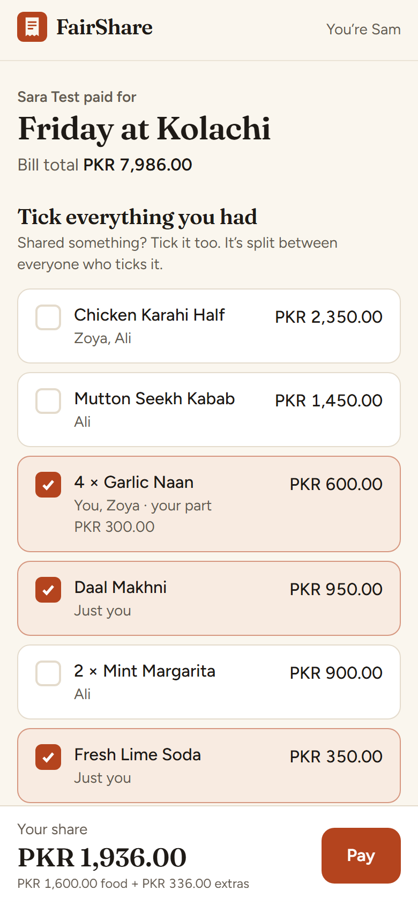
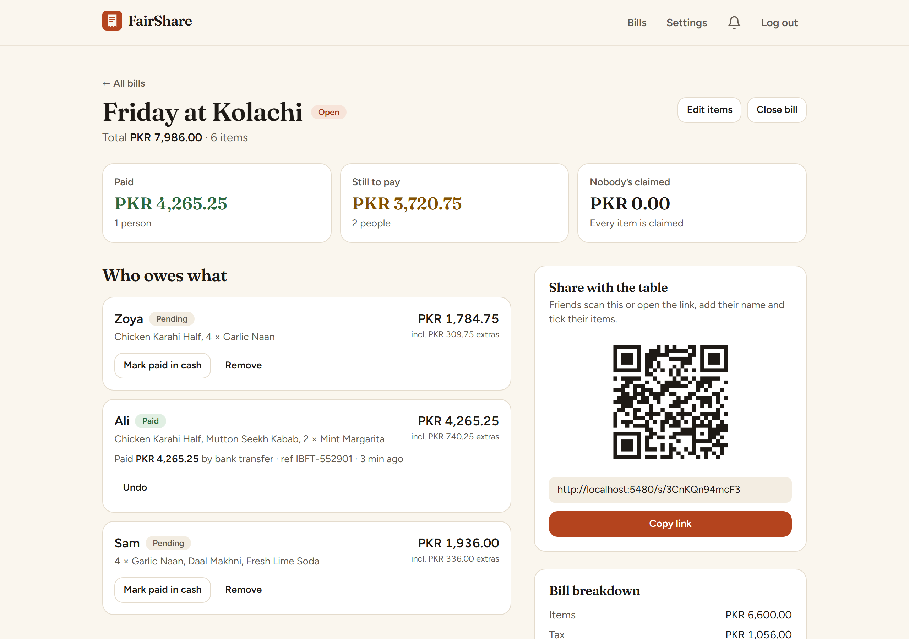

# FairShare

Split a restaurant bill by what everyone actually ordered. The host photographs the receipt, FairShare reads the items, and friends open one link, type a name and tick what they had. Shared dishes are split evenly between the people who shared them, tax and service charge are split in proportion to each person's food, and the host sees who has paid.

**Live demo:** https://fairshare-mauve.vercel.app

<p>
  
  
</p>

<sub>Screenshots are from a local run with sample data (a generated receipt and test names). Card payments run in Stripe test mode.</sub>

## Features

- **Receipt reading.** Upload or take a photo; a vision model extracts items, subtotal, tax, service charge and discounts. The host reviews and edits every line before sharing.
- **Guest access.** Friends join with just a nickname; no account needed.
- **Fair maths.** Shared items split equally; tax, service charge and tip are allocated as `your items × (1 + extras ÷ bill subtotal)`. All money is integer paisa/cents with largest-remainder rounding, so shares always add up to the receipt exactly.
- **Payments.** Card through Stripe Checkout (test mode), or bank transfer / IBFT with the host's account details and a QR code. Card payments are confirmed by a verified Stripe webhook; bank transfers are confirmed by the host.
- **Live ledger and notifications.** Paid, pending and unclaimed totals refresh automatically, and the host gets an in-app notification for each payment.

## Tech stack

| Layer | |
|---|---|
| Frontend | React 19, Vite, Tailwind CSS 4, React Router (plain JSX) |
| Backend | Laravel 13 REST API, Sanctum bearer tokens, database queue |
| Database | MySQL or PostgreSQL in production; SQLite for local dev and tests |
| Receipt reading | OpenRouter free vision models (default `nvidia/nemotron-3.5-super-vl:free`, falling back to Gemma 4) |
| Payments | Stripe Checkout over its REST API (no SDK) |

## Local setup

Requirements: PHP 8.3+ with `pdo_sqlite`, `gd`, `exif` and `fileinfo`; Composer; Node 20+.

```bash
cd api
composer install
cp .env.example .env
php artisan key:generate
touch database/database.sqlite
php artisan migrate
php -S 127.0.0.1:8480 -t public public/index.php
```

In a second terminal, run the queue worker that reads receipts:

```bash
cd api && php artisan queue:work --tries=1 --timeout=90
```

And the frontend (it proxies `/api` to port 8480):

```bash
cd web && npm install && npm run dev -- --port 5480
```

Open http://localhost:5480.

### Environment variables (`api/.env`)

| Variable | Purpose |
|---|---|
| `FRONTEND_URL` | Origin of the React app, for CORS and payment return links |
| `RECEIPT_READER` | `openrouter` (default) or `manual` (host types items) |
| `AI_API_KEY` | OpenRouter API key; free models need no credits. Without it, receipt reading is off and hosts type items in |
| `AI_MODEL` | Comma-separated models to try in order |
| `STRIPE_SECRET`, `STRIPE_WEBHOOK_SECRET` | Stripe **test-mode** keys. Leave empty to hide card payments |
| `DB_*` | Database connection for production |

The web app reads `VITE_API_URL` (the API origin) at build time; leave it empty locally.

## Tests

```bash
cd api && php artisan test      # 27 tests: split maths, auth, upload hardening, guest isolation, payments, Stripe webhooks
cd web && npm run lint && npm run build
```

## Security notes

- Hosts only ever see their own bills (other ids return 404); guests act only through their own hashed participant token.
- Receipt uploads are checked by their real bytes, size-capped, re-encoded (which strips GPS/EXIF data), given random names and kept outside the web root.
- Bank details are encrypted at rest. Card data never reaches the server.
- Stripe webhooks are verified with a timing-safe HMAC check and a timestamp window, deduplicated by event id, and cross-checked against the amount and currency we asked Stripe to charge.
- Rate limits on auth, uploads, joining, claiming and webhooks; security headers on API and web responses.

See [SECURITY.md](SECURITY.md) to report a vulnerability.

## Known limitations

- Receipt reading on free models takes about 10–25 seconds, slower than the 5-second target in the original requirements. A paid model or a dedicated OCR service would be needed to meet it.
- Card payments go to the platform's Stripe account. Paying the host directly would need Stripe Connect onboarding, so cards stay in test mode.
- Updates use short polling rather than WebSockets.

## License

[MIT](LICENSE)
